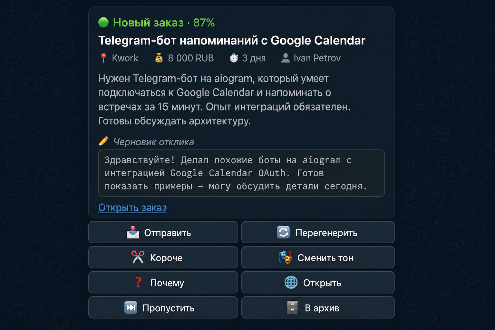
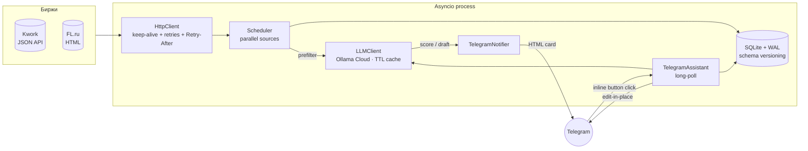

# freelance-bot

> AI-ассистент для фрилансера: парсит Kwork и FL.ru, оценивает релевантность заказов LLM-моделью и присылает только подходящие — с готовым черновиком отклика и интерактивными кнопками прямо в Telegram.

<p align="center">
  
</p>

<p align="center">
  
  
  
  
  
  
  
</p>

---

## Зачем это

Фриланс-биржи показывают сотни заказов в день, из них релевантных ~5-15. Сидеть целый день в ленте и фильтровать вручную — потеря времени. Бот делает это сам:

- парсит Kwork (JSON API) и FL.ru (HTML через `selectolax`) каждые 60 секунд;
- **подгружает полное описание заказа** перед скорингом, не довольствуясь обрезанным превью с ленты;
- LLM (Ollama Cloud, `gpt-oss:120b`) даёт скор `0..100` в JSON-mode;
- если ≥ порога — карточка прилетает в Telegram с готовым черновиком отклика;
- одним кликом можно перегенерить, сменить тон (деловой / дружелюбный / жёсткий), укоротить, спросить «почему», открыть на бирже, пометить отправленным или скрыть.

## Демо UX

| Шаг | Что происходит |
|---|---|
| 🟢 Карточка приходит | Заголовок, источник, бюджет, срок, заказчик, описание (полное), черновик отклика в `<pre>`-блоке, ссылка на заказ |
| 📨 Отправить | Карточка in-place превращается в `✅ Отправлено`, остаётся одна кнопка «🌐 Открыть заказ». Идемпотентно — повторно нажать нельзя |
| 🔄 Перегенерить / ✂️ Короче | Та же карточка обновляется новым черновиком, **новые сообщения в чат не плодятся** |
| 🎭 Сменить тон | Submenu прямо в карточке: 💼 Деловой / 🤝 Дружелюбный / 🔥 Жёсткий → ← Назад |
| ❓ Почему | Бот объясняет в reply: «что совпало / какие пробелы / брать или нет» |
| ⏭ Пропустить / 🗄 В архив | Карточка свернётся в финальный статус с одной кнопкой «Открыть» |

Команды в чате:

```
/help        список всех команд
/stats       24h-сводка: новых, прошли порог, отправлено, по источникам, LLM hit/miss
/digest      сводка дня: топ-5 отправленных + топ-5 нерасхваченных ≥ порог
/threshold N поменять порог релевантности без рестарта
/pause /resume  поставить опрос на паузу
/skills      показать MY_SKILLS, который видит модель
```

## Архитектура



### Поток одного цикла

```
каждые 60с:
  ├─ asyncio.gather(Kwork.fetch, FL.ru.fetch)          # параллельно
  │     ├─ Kwork: 3 категории × N страниц параллельно
  │     └─ FL.ru: 2 категории параллельно × N страниц последовательно
  │
  ├─ для каждого нового заказа (URL не в БД):
  │     ├─ INSERT OR IGNORE … RETURNING id              # атомарно, без exists+save гонки
  │     ├─ если age_minutes > FRESH_ORDER_MAX_AGE_MINUTES — пропустить
  │     ├─ если не проходит prefilter (include/exclude keywords) — пропустить
  │     ├─ FL.ru: GET страницу заказа → JSON-LD → полное описание → UPDATE  ←  ключевая оптимизация
  │     ├─ LLM.score_relevance(skills, title, description) → JSON-mode {"score": N}
  │     │      └─ TTL-cache по SHA-1(skills, title, desc), 1 час
  │     ├─ если N ≥ runtime.threshold:
  │     │      ├─ LLM.generate_reply_draft(...)          # TTL-cache 30 мин
  │     │      └─ TelegramNotifier.send_order(card)
  │     └─ ровно так, без блокировок других заказов
  │
  └─ раз в N циклов: db.cleanup_old(applied=0, older than 30d)
```

## Стек

- **Python 3.9+** · asyncio everywhere
- **aiogram 3.7+** — Telegram Bot API, inline-keyboards, edit-in-place UX
- **aiohttp 3.9+** — общий `HttpClient` с `TCPConnector(limit=20)`, `Retry-After`, экспоненциальный backoff с jitter
- **aiosqlite 0.20+** — WAL-mode, версионируемые миграции через `_meta.schema_version`, индексы, `INSERT OR IGNORE`
- **selectolax 0.3.21+** — Cython HTML-парсер (≈3× быстрее `lxml`, ≈10× быстрее BeautifulSoup) для FL.ru
- **Ollama Cloud** (`gpt-oss:120b`) — LLM, JSON-mode для скоринга
- **cachetools 5.3+** — TTL-кэш LLM по SHA-1 от prompt'а
- **pytest + pytest-asyncio** — 73 теста: парсеры на golden-фикстурах, БД на временной SQLite, рендер HTML-карточки, парсеры score JSON/heuristic, runtime state
- **ruff + GitHub Actions** — линтер + CI на Python 3.9 и 3.11

## Что измерено

Цифры с реальной БД (~900 заказов за день):

| Метрика | До оптимизации | После |
|---|---:|---:|
| **FL.ru: средняя длина описания** | 151 символ (превью) | **631 символ** (×4.2) |
| **FL.ru: cards parsed/page** | ~30 (regex) | ~30 (selectolax) — но устойчиво при правках вёрстки |
| **Kwork: время на цикл** (3 категории × 10 стр) | ~3 сек последовательно | ~0.7 сек параллельно с Semaphore(4) |
| **Бирж параллельно** | 1 (sequential) | 2 (`asyncio.gather`) |
| **LLM repeat-call cost** (Перегенерить · Короче · Сменить тон по одному заказу) | 3 LLM-вызова | 1 + 2 cache hits |
| **Score parser failure** на ответе `100% не подходит, 0/100` | возвращал 100 | возвращает 0 (last bounded number) |
| **Score parsing strategy** | regex на первое число | JSON-mode `{"score": N}` + heuristic fallback |
| **Send button** до фикса миграции `applied/applied_at` | падал с `OperationalError` | работает идемпотентно через in-memory set + DB |
| **HTML escape** | частичный | все поля через `html.escape`, url с `quote=True` |
| **Re-score after full-description backfill** | — | 250 заказов сменили скор, 30+ промоушенов 0 % → 70-95 % |

## Quick start

```bash
git clone <this-repo>
cd freelance-bot

python3 -m venv .venv && source .venv/bin/activate
pip install -r requirements.txt

cp .env.example .env
# заполни TELEGRAM_BOT_TOKEN, TELEGRAM_CHAT_ID, OLLAMA_API_KEY, MY_SKILLS,
# опционально KWORK_COOKIES / FLRU_COOKIES

python main.py
```

или через Docker:

```bash
docker build -t freelance-bot .
docker run --rm -it --env-file .env -v $(pwd)/orders.db:/app/orders.db freelance-bot
```

### Переменные окружения

| Переменная | По умолчанию | Что это |
|---|---:|---|
| `TELEGRAM_BOT_TOKEN` | — | токен из @BotFather |
| `TELEGRAM_CHAT_ID` | — | id чата для уведомлений |
| `OLLAMA_API_KEY`, `OLLAMA_MODEL` | `gpt-oss:120b` | Ollama Cloud (см. ollama.com) |
| `MY_SKILLS` | — | описание стека для LLM (описательная фраза работает лучше, чем список keyword'ов) |
| `PREFILTER_INCLUDE_KEYWORDS` | — | через запятую — что пропускать в LLM |
| `PREFILTER_EXCLUDE_KEYWORDS` | — | что отсекать до LLM |
| `RELEVANCE_THRESHOLD` | `70` | порог уведомлений 0..100 |
| `DRAFT_MODE` | `1` | прикреплять черновик к карточке |
| `DRAFT_MAX_CHARS` | `700` | хардкап **1500** в коде (Telegram limit 4096) |
| `POLL_INTERVAL_SECONDS` | `60` | интервал цикла |
| `SOURCE_MAX_PAGES` | `10` | сколько страниц на категорию |
| `FRESH_ORDER_MAX_AGE_MINUTES` | `30` | окно свежести (0 — выключить) |
| `KWORK_CATEGORIES` | `41,11,45` | 41=программирование, 11=сайты, 45=мобильная |
| `KWORK_COOKIES`, `FLRU_COOKIES` | — | для авторизованных лент (опционально) |
| `CLEANUP_MAX_AGE_DAYS` | `30` | удалять неприменённые старше N дней |
| `LOG_LEVEL` | `INFO` | DEBUG / INFO / WARNING / ERROR |

## Тесты

```bash
pytest -q       # 73 теста за ~1 сек
ruff check .    # линтер
```

CI на каждом PR: `.github/workflows/ci.yml` гоняет ruff + pytest на Python 3.9 и 3.11.

Что покрыто:
- `tests/test_flru_parser.py` — golden-фикстура листинговой страницы, ≥25 карточек, ≥50% age-coverage, нет дублей;
- `tests/test_flru_full_description.py` — JSON-LD primary, CSS fallback, нормализация абзацев;
- `tests/test_kwork_parser.py` — schema sanity, MSK→UTC всегда сдвигает на 3 часа;
- `tests/test_db.py` — миграции, dedup, mark_applied, stats, top_unhandled, cleanup_old (сохраняет applied);
- `tests/test_llm_parsers.py` — JSON / heuristic парсеры score + smart truncate;
- `tests/test_runtime_state.py` — pause / resume / threshold clamping;
- `tests/test_notifier.py` — HTML escape, скрытие placeholder-полей, все 4 клавиатуры (no-draft / with-draft / tone-submenu / finalised).

## Структура

```
freelance-bot/
├── main.py                 # entrypoint: поднимает HttpClient, DB, LLM, Notifier, Scheduler, Assistant
├── scheduler.py            # parallel-fetch → prefilter → full-description → LLM → notify
├── exchanges/
│   ├── base.py             # Order dataclass, Exchange ABC
│   ├── kwork.py            # JSON API, Europe/Moscow timezone, Semaphore(4)
│   └── flru.py             # selectolax-парсер ленты + полное описание со страницы заказа
├── llm.py                  # Ollama Cloud client, JSON-mode + fallback, TTL-cache
├── notifier.py             # рендер карточки (HTML escape), 4 inline keyboards, edit-in-place
├── telegram_assistant.py   # long-poll, idempotent Send, tone submenu, /stats /digest /threshold
├── db.py                   # aiosqlite + WAL, _meta-versioned migrations, atomic save_order_if_new
├── http_client.py          # shared aiohttp.ClientSession + retries + Retry-After
├── config.py               # Settings dataclass (env-loaded, bounded), DRAFT_MAX_CHARS hard cap
├── runtime_state.py        # in-memory mutable state for /pause /threshold
├── logging_setup.py        # cycle_id / order_url ContextVars in every log line
├── tests/                  # pytest + golden HTML/JSON fixtures (sanitized, committed)
├── .github/workflows/ci.yml
├── pyproject.toml          # ruff + mypy
├── Dockerfile
└── README.md
```

## FAQ

**Q. Почему не webhook, а long-poll `getUpdates`?**
A. Single-tenant домашний бот. Webhook требует домена + TLS + reverse-proxy. Polling даёт zero-config за счёт ~50 мс лишней латентности на клик. Для smoothing'а сетевых блипов в `run_forever` отдельно ловятся `TelegramConflictError` (одна копия бота), `TelegramRetryAfter` (rate limit), `TelegramNetworkError` (connection reset) — каждый со своей логикой backoff'а вместо общей `except Exception`.

**Q. Почему `selectolax`, а не BeautifulSoup?**
A. На странице FL.ru ~330 КБ HTML и ~30 карточек × 5+ полей в каждой = тысячи DOM-обращений за цикл. Selectolax (Cython-обёртка над `modest` HTML-парсером) быстрее BeautifulSoup в ~10×, и быстрее `lxml` в ~3×. На 10 страницах разница 0.5-1 сек на цикл.

**Q. Зачем JSON-LD primary + CSS fallback в FL.ru?**
A. CSS-классы FL.ru переименовываются молча — мы это уже видели. JSON-LD (`<script type="application/ld+json">` со `schema.org/Product`) — открытый стандарт, ломается раз в N лет, а не на каждом релизе. Если JSON-LD внезапно не валиден или его нет, fallback на `div.fl-project-content__description-text`.

**Q. Что насчёт промпт-инъекций в описании заказа?**
A. Описание проходит через `html.escape(quote=True)` перед попаданием в Telegram-карточку. В сам LLM-prompt мы не пропускаем control-символы, но семантическую injection не фильтруем — для скоринга это ОК (модель просто оценит «релевантно или нет»), а в `generate_reply_draft` отклик идёт пользователю на ревью, не отправляется автоматически.

**Q. Почему `gpt-oss:120b`, а не GPT-4 / Claude?**
A. Ollama Cloud дешевле для high-volume scoring. Для draft-генерации можно подменить модель в одной строке `.env` без изменения кода — `LLMClient` принимает `OLLAMA_MODEL`.

**Q. Где LaunchAgent / systemd?**
A. Не входит в repo (зависит от системы). Шаблон `LaunchAgent`-plist для macOS даю под запрос.

## License

[MIT](LICENSE) — пользуйтесь, форкайте, коммерчески тоже можно.
